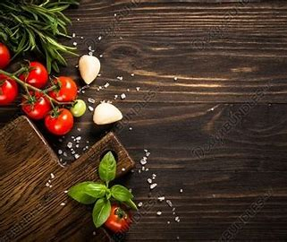

# 🍔 Foodie Express — Gourmet Food Delivery & Restaurant Platform



> **A modern, full-stack food ordering, real-time dispatch, table reservation, and restaurant management platform.**

[](https://foodie-express-liard-one.vercel.app/)
[](https://foodie-backend-vc6z.onrender.com/api/health)
[](https://spring.io/projects/spring-boot)
[](https://tidbcloud.com/)
[](LICENSE)

---

## 🌐 Live Demo & Deployments

- **Production Frontend (Vercel):** [https://foodie-express-liard-one.vercel.app/](https://foodie-express-liard-one.vercel.app/)
- **Alternative Vercel Mirror:** [https://foodie-express-delivery-five.vercel.app/](https://foodie-express-delivery-five.vercel.app/)
- **Live Production API (Render):** [https://foodie-backend-vc6z.onrender.com/api/health](https://foodie-backend-vc6z.onrender.com/api/health)
- **Local Development URL:** `http://localhost:3000` (Frontend) & `http://localhost:8080` (Backend API)

---

## 🔑 Demo Access & Login Credentials

Foodie Express includes 3 tailored role-based portals. You can use these pre-seeded test accounts:

| Portal Role | Access URL | Email | Password | Included Permissions |
| :--- | :--- | :--- | :--- | :--- |
| **Admin** | [`/admin/dashboard.html`](https://foodie-express-liard-one.vercel.app/admin/dashboard.html) | `admin@foodie.com` | `Admin@123` | Full analytics, menu item CRUD, category management, reservations & live orders overview |
| **Supervisor** | [`/supervisor/dashboard.html`](https://foodie-express-liard-one.vercel.app/supervisor/dashboard.html) | `supervisor@foodie.com` | `Supervisor@123` | Kitchen dispatch, order progress updates, rider assignment & operations |
| **Customer** | [`/customer/login.html`](https://foodie-express-liard-one.vercel.app/customer/login.html) | `customer@foodie.com` | `Customer@123` | Browse catalog, category filters, cart, reservations, profile & checkout |

> **Password Note:** Passwords are case-sensitive and hashed using BCrypt.

---

## 🚀 Key Features

- **📱 Customer Storefront:**
  - Modern responsive landing page with background promotional video.
  - Category filtering (`Pure Veg`, `Non-Veg`, `Indian Heritage`, `Snacks`, `Desserts`).
  - Interactive dish search, dynamic catalog, wishlist, and cart drawer.
  - Real-time online table booking and table reservation manager.
  - Razorpay / UPI checkout flow and order history tracking.

- **👨‍🍳 Supervisor Operations Hub:**
  - Live kitchen orders dispatch screen.
  - Real-time order status transitions: *Pending* $\rightarrow$ *Preparing* $\rightarrow$ *Out for Delivery* $\rightarrow$ *Delivered*.
  - Order details and delivery tracking info.

- **🛡️ Admin Management Console:**
  - Real-time sales metrics, revenue, active customer counts, and order statistics.
  - Full CRUD operations for Menu Dishes and Food Categories.
  - Customer profile administration and feedback review.

- **🔐 Enterprise Security & Architecture:**
  - Stateless JWT (JSON Web Token) authentication with Spring Security 6.
  - Role-based authorization (`ROLE_ADMIN`, `ROLE_SUPERVISOR`, `ROLE_CUSTOMER`).
  - Auto-seeding database service with BCrypt password encoding.
  - TiDB Serverless Cloud MySQL with TLS/SSL encryption.

---

## 🏗️ System Architecture

```
Foodie-Express/
├── Foodie-Express-Frontend/          # Client-side web application
│   ├── customer/                     # Storefront, cart, menu, reservations, profile
│   ├── admin/                        # Admin dashboard, dishes, categories, settings
│   ├── supervisor/                   # Supervisor dispatch console & orders
│   ├── js/ & shared/                 # Universal app.js, API clients, auth helpers
│   ├── css/                          # Custom modular CSS & responsive breakpoints
│   ├── images/ & video/              # High-definition food media & MP4 video hero
│   ├── server.js                     # Local Node.js static & streaming web server
│   ├── vercel.json                   # Vercel deployment routes & rewrites
│   └── package.json                  # Frontend scripts
│
└── Foodie-Express-Backend/           # Java Spring Boot 3 REST API
    ├── src/main/java/.../
    │   ├── Controller/               # User, Menu, Order, Reservation, Health APIs
    │   ├── Entity/                   # JPA database entities (User, MenuItem, Order, etc.)
    │   ├── Repository/               # Spring Data JPA repositories
    │   ├── Security/                 # JWT Authentication Filter & SecurityConfig
    │   └── Service/                  # Business logic & DataInitializerService (Auto-seed)
    ├── src/main/resources/
    │   └── application.properties    # Environment & database properties
    ├── Dockerfile                    # Multi-stage production container build
    ├── pom.xml                       # Maven dependencies
    └── mvnw.cmd / mvnw               # Maven wrapper
```

---

## 💻 How to Run the Project Locally

### Prerequisites

Ensure you have the following installed:
- **Node.js** (v18 or higher) — [Download Node.js](https://nodejs.org/)
- **Java JDK 17 or higher** — [Download Eclipse Temurin JDK](https://adoptium.net/)
- **Git** — [Download Git](https://git-scm.com/)

---

### Step 1: Clone the Repository

```bash
git clone https://github.com/IsravelTECH/Foodie-Express-Frontend.git
cd Foodie-Express
```

---

### Step 2: Run the Frontend

1. Navigate to the frontend folder:
   ```bash
   cd Foodie-Express-Frontend
   ```
2. Start the local server:
   ```bash
   npm start
   ```
   *(Or run `node server.js` directly)*

3. Open your browser:
   - **Frontend App:** [http://localhost:3000](http://localhost:3000)
   - **Customer Portal:** [http://localhost:3000/customer/index.html](http://localhost:3000/customer/index.html)
   - **Admin Console:** [http://localhost:3000/admin/dashboard.html](http://localhost:3000/admin/dashboard.html)
   - **Supervisor Hub:** [http://localhost:3000/supervisor/dashboard.html](http://localhost:3000/supervisor/dashboard.html)

---

### Step 3: Run the Backend (Optional for Local API)

1. Open a new terminal and navigate to the backend folder:
   ```bash
   cd Foodie-Express-Backend
   ```
2. Configure your TiDB or MySQL connection variables (in Windows PowerShell):
   ```powershell
   $env:SPRING_DATASOURCE_URL="jdbc:mysql://gateway01.us-east-1.prod.aws.tidbcloud.com:4000/test?useSSL=true&requireSSL=true&allowPublicKeyRetrieval=true&serverTimezone=UTC"
   $env:SPRING_DATASOURCE_USERNAME="Guxc8mpfcqbm4Z8.root"
   $env:SPRING_DATASOURCE_PASSWORD="TW5JPkYwhvU0LFlU"
   $env:PORT="8080"
   ```
   *(Or on Linux/macOS `export SPRING_DATASOURCE_URL=...`)*

3. Run the Spring Boot application using Maven Wrapper:
   - **Windows:**
     ```powershell
     .\mvnw.cmd spring-boot:run
     ```
   - **Linux / macOS:**
     ```bash
     ./mvnw spring-boot:run
     ```
4. Verify the backend health:
   ```bash
   curl http://localhost:8080/api/health
   # Response: {"status":"UP"}
   ```

---

## ☁️ Deployment Guide

### Deploying the Backend on Render

1. Go to [Render Dashboard](https://dashboard.render.com/) $\rightarrow$ **New Web Service**.
2. Connect your repository and select the `Foodie-Express-Backend` directory.
3. Configure settings:
   - **Runtime:** `Docker` (or Java with Build Command: `./mvnw clean package -DskipTests` & Start Command: `java -jar target/foodie-backend-0.0.1-SNAPSHOT.jar`)
   - **Health Check Path:** `/api/health`
4. In the **Environment Variables** tab, add:
   ```env
   PORT=8080
   SPRING_DATASOURCE_URL=jdbc:mysql://gateway01.us-east-1.prod.aws.tidbcloud.com:4000/test?useSSL=true&requireSSL=true&allowPublicKeyRetrieval=true&serverTimezone=UTC
   SPRING_DATASOURCE_USERNAME=Guxc8mpfcqbm4Z8.root
   SPRING_DATASOURCE_PASSWORD=TW5JPkYwhvU0LFlU
   SPRING_JPA_HIBERNATE_DDL_AUTO=update
   SPRING_JPA_SHOW_SQL=false
   JWT_SECRET=9a4f2c8d3e5b7a1f6c8d2e4a7b9c1d3f5a7b9c1d3f5a7b9c1d3f5a7b9c1d3f5a
   JWT_EXPIRATION=86400000
   FRONTEND_URL=https://foodie-express-liard-one.vercel.app,https://foodie-express-delivery-five.vercel.app,http://localhost:3000
   ```
5. Click **Deploy Web Service**.

---

### Deploying the Frontend on Vercel

1. Go to [Vercel](https://vercel.com/) $\rightarrow$ **Add New Project**.
2. Select your `Foodie-Express-Frontend` repository.
3. Framework Preset: **Other** / **Static Site**.
4. Root Directory: `./` (or `Foodie-Express-Frontend`).
5. In **Environment Variables**, add:
   - `API_BASE_URL` = `https://foodie-backend-vc6z.onrender.com`
   - `FOODIE_API_BASE_URL` = `https://foodie-backend-vc6z.onrender.com`
6. Click **Deploy**.

---

## 🛠️ Tech Stack & Libraries

- **Frontend:** Semantic HTML5, Modular CSS3, Modern ES6+ JavaScript, FontAwesome 6, Google Fonts (Plus Jakarta Sans, Inter).
- **Backend:** Java 17+, Spring Boot 3.4.4, Spring Security 6, Spring Data JPA, Hibernate, JJWT.
- **Database:** TiDB Cloud Serverless MySQL (with SSL).
- **Deployment & Cloud:** Vercel (Edge Static Hosting), Render (Cloud Docker Backend), GitHub Actions.

---

## 📄 License

This project is licensed under the MIT License — feel free to use and adapt it for learning or commercial deployment.

---

⭐ **Star this repository if you find Foodie Express helpful!**
